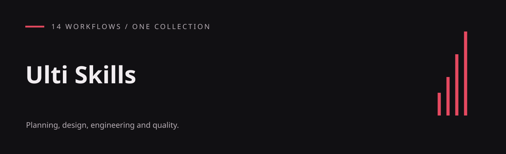
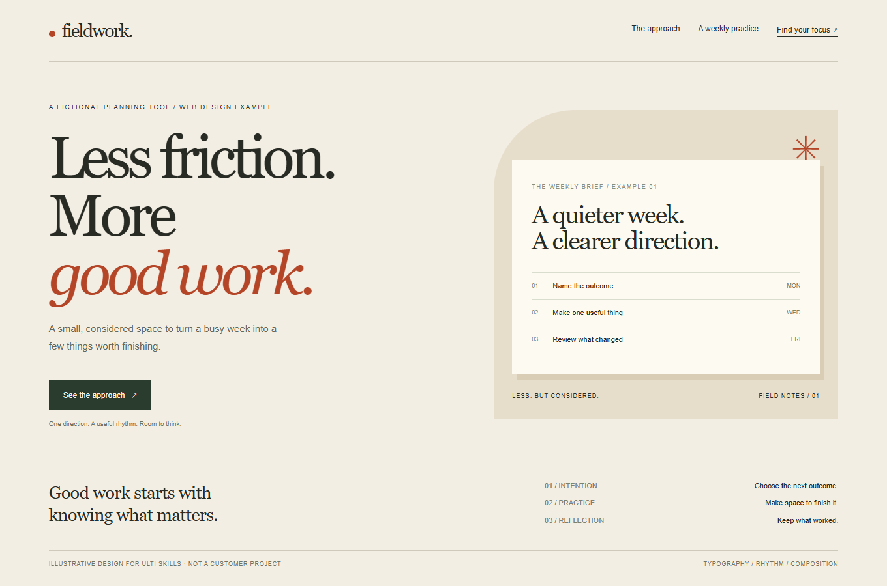
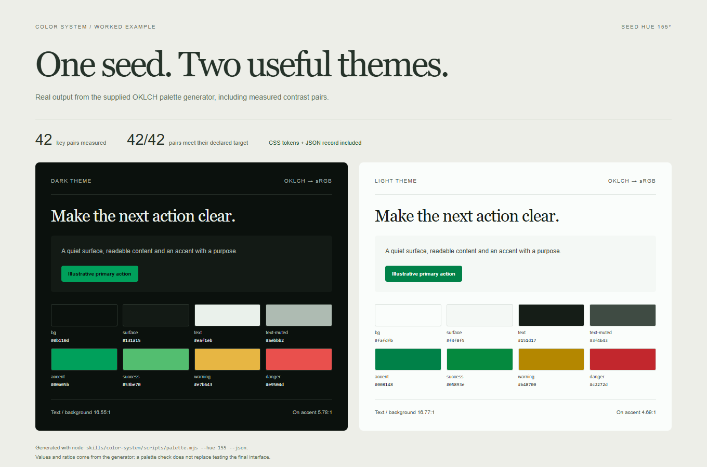
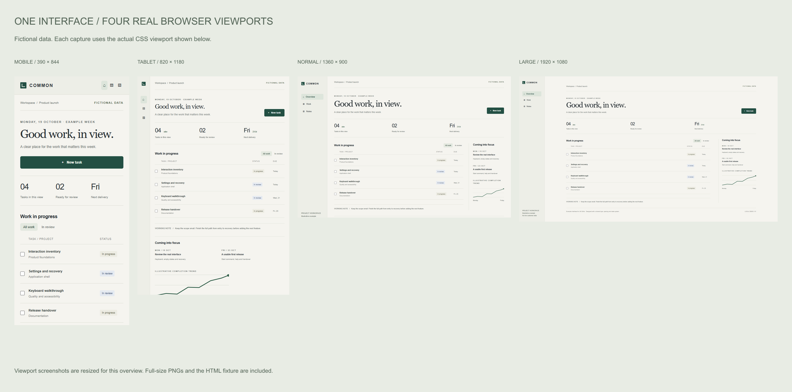
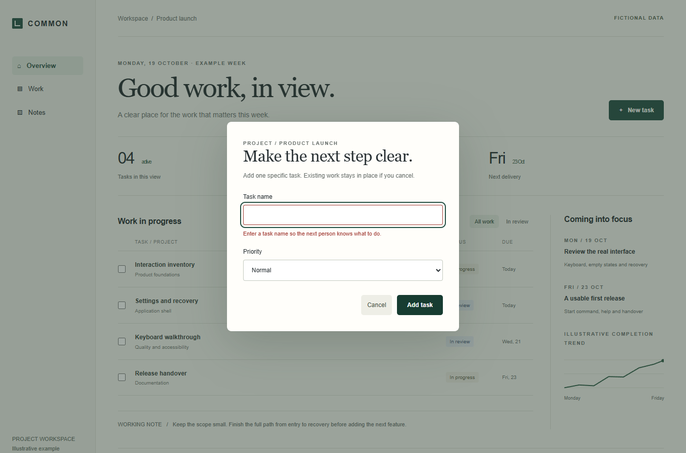
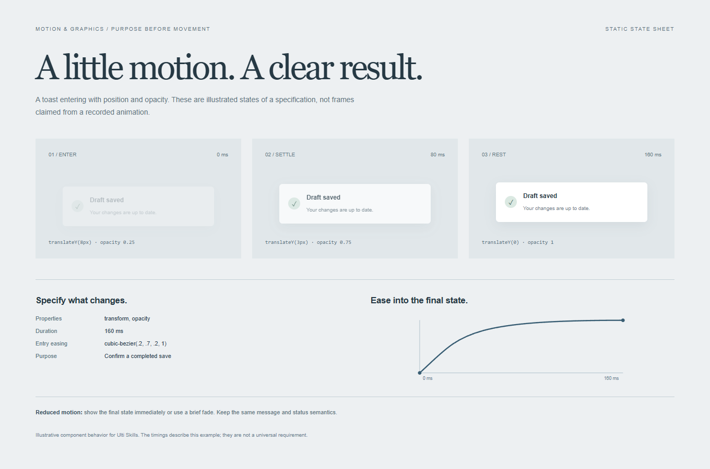

# Ulti Skills

**14 general-purpose agent skills for planning, design, engineering and quality.**

An English-language collection from the Cadence project, released under the [MIT license](LICENSE). Each skill has its own `SKILL.md`, usage guide and any supporting references or dependency-free helpers. This repository contains the skill library, not the Cadence application.

## Visual examples

Real browser renders of the included example sources. The interfaces use fictional data; these are illustrations of the methods, not customer work or guaranteed outputs from an agent run. Click any image for the full-size PNG.

| Interface design | Editorial web design |
|---|---|
| [](.github/examples/interface.png) | [](.github/examples/web-design.png) |
| [Design Craft](skills/design-craft/README.md) · [Complete App](skills/complete-app/README.md) | [Web Design Craft](skills/web-design-craft/README.md) |

| Generated color system | Four real viewport classes |
|---|---|
| [](.github/examples/color-system.png) | [](.github/examples/responsive.png) |
| [Color System](skills/color-system/README.md) · 42/42 declared contrast pairs pass | [Responsive Evidence](skills/responsive-evidence/README.md) · full-size captures included |

| Validation and recovery | Motion specification |
|---|---|
| [](.github/examples/form-recovery.png) | [](.github/examples/motion-states.png) |
| [Usability Review](skills/usability-review/README.md) · exercised in Chromium | [Motion & Graphics](skills/motion-and-graphics/README.md) · static illustrated states |

[Example source and reproduction steps](examples/README.md) · [Capture metadata](.github/examples/capture-info.json)

## Install and use

```sh
git clone https://github.com/hellinckx/ulti-skills.git
```

Choose a folder under `skills/` and copy it, complete, into your project's `.agents/skills/` directory. For example, copy `skills/goal-to-plan` to `.agents/skills/goal-to-plan`. Inspect any existing destination first; do not overwrite another skill. For user-wide installation, use your agent's configured skills directory instead.

Then ask your agent:

```text
Use $goal-to-plan to turn a local workshop inventory app idea into requirements,
dependencies and measurable acceptance criteria.
```

Other agents can read a selected `SKILL.md` directly or use their own multi-skill repository installer. Read the individual README for its intended use, prerequisites and example. Related skills are included here but are loaded separately as needed.

## Skill catalog

| Skill | Purpose |
|---|---|
| [ab-testing](skills/ab-testing/README.md) | Design experiments before collecting data and turn variant comparisons into auditable decisions. |
| [ai-app-engineering](skills/ai-app-engineering/README.md) | Build applications with explicit provider connections, model selection, agent tools and operational boundaries. |
| [color-system](skills/color-system/README.md) | Create deliberate OKLCH palettes, semantic tokens and measured contrast across themes. |
| [complete-app](skills/complete-app/README.md) | Deliver applications with the settings, persistence, help and recovery behavior people expect. |
| [design-craft](skills/design-craft/README.md) | Give interfaces a clear visual direction and a transferable design specification. |
| [goal-to-plan](skills/goal-to-plan/README.md) | Turn a short product goal into requirements, dependencies and a verifiable delivery plan. |
| [load-stress-testing](skills/load-stress-testing/README.md) | Measure application behavior under realistic data volume and concurrent use in a controlled staging environment. |
| [motion-and-graphics](skills/motion-and-graphics/README.md) | Choose purposeful interface motion and build accessible, efficient 2D and 3D visuals. |
| [project-structure](skills/project-structure/README.md) | Keep project folders understandable through responsibility-based organization and safe, scoped moves. |
| [responsive-evidence](skills/responsive-evidence/README.md) | Verify actual interface adaptation and preserve screenshots and observations across four viewport classes. |
| [security-testing](skills/security-testing/README.md) | Find, reproduce and fix security weaknesses in authorized systems using controlled, non-destructive checks. |
| [usability-review](skills/usability-review/README.md) | Evaluate real task completion, discoverability, keyboard access and recovery in a running interface. |
| [venture-blueprint](skills/venture-blueprint/README.md) | Turn an idea into a prepared project folder that another agent can inspect and continue. |
| [web-design-craft](skills/web-design-craft/README.md) | Build distinctive web surfaces from deliberate composition, typography, spacing and interaction decisions. |

## Requirements

- An agent that supports skills or can read Markdown instructions and local files.
- Node.js 18 or newer for the nine optional `.mjs` helpers. No npm dependencies are required.
- Browser or application tools for workflows that verify real interfaces.
- The integrations required by your own project. The collection does not provide an agent runtime or account connections.

For a helper example, run this from `skills/web-design-craft/`:

```sh
node scripts/type-scale.mjs --base 16 --ratio 1.25 --ratio-sm 1.2 --css
```

## Scope and safety

Installing a skill does not authorize external actions or expand workspace permissions. Messages, publications, spending, submissions and destructive actions require the authorization specified by the task and runtime. Never commit credentials, private evidence or customer data.

The current collection review includes all 14 skill entrypoints, all nine Node helpers, file references and credential-pattern checks. Fourteen targeted security regressions pass. The exported helpers include narrowly scoped corrections for linked filesystem paths and malformed security findings; the original Takt project remains unchanged. See [security notes](SECURITY.md) for scope and limits.

Provider protocol examples require verification against the runtime you actually use. Provenance metadata and stable schema identifiers are retained; the collection does not prescribe a Cadence house style.

## Layout

```text
skills/
  <skill-name>/
    SKILL.md
    README.md
    assets/       # when provided
    references/   # when provided
    scripts/      # when provided
examples/         # illustrative HTML sources and optional renderer
.github/examples/ # real PNG captures and metadata
LICENSE
SECURITY.md
```

## Provenance and license

Prepared from Cadence's built-in skill library with provenance metadata retained. This curated collection keeps the reusable project workflows; domain-specific business routines and the Cadence house design system are excluded. No private application history or local audit archives are included.

[MIT](LICENSE) — Copyright (c) 2026 hellinckx.
