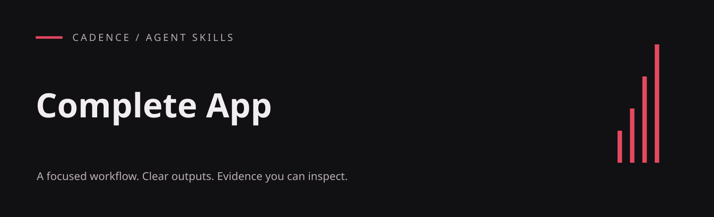
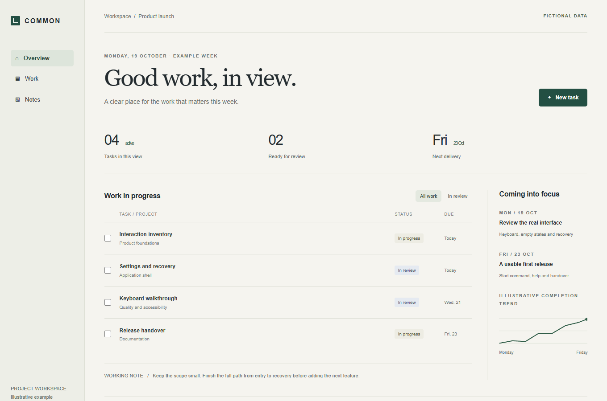

# Complete App

Deliver applications with the settings, persistence, help and recovery behavior people expect.

An English-language agent skill from the Cadence project, included in the Ulti Skills collection. The workflow lives in [SKILL.md](SKILL.md); this repository does not include the Cadence application.

## What it produces

- A complete application shell with useful states
- Central settings, help and accessible interactions
- Documented startup and end-to-end acceptance

## Visual example

### A working interface slice



A small in-memory example with task creation, filtering, validation and keyboard recovery. It illustrates part of the delivery checklist; it is not a complete project-management product.

[Full-size image](../../.github/examples/interface.png) · [HTML source](../../examples/interface.html) · [Reproduce the captures](../../examples/README.md)

## Install

For a project-local Codex installation, run this from your project root (Git required):

```sh
git clone https://github.com/hellinckx/ulti-skills.git
```

Copy `ulti-skills/skills/complete-app` into your project at `.agents/skills/complete-app`. Keep the entire skill folder together so relative references and helpers stay available. If that destination already exists, inspect it before updating; do not clone over unrelated work. For a user-wide installation, copy the selected skill folder into your configured Codex skills directory instead. Other agents can load [SKILL.md](SKILL.md) directly or use their own skill installation mechanism.

## Use

Example request:

```text
Use $complete-app.
Audit this local app for missing settings, help, persistence and recovery states. Build a completion checklist and verify the documented startup path.
```

## Requirements and integration

Use an agent that can read `SKILL.md`, project files and any local reference files supplied with this skill.

This skill contains instructions; it does not install a service, schedule a task or run code automatically.

## Related skills

The instructions describe handoffs to these other skills in the same collection; install the ones your task needs:

- [Responsive Evidence](https://github.com/hellinckx/ulti-skills/tree/main/skills/responsive-evidence)

## Boundaries

Installing a skill grants no account access or permission to send messages, publish, spend money or change unrelated files. Use only the tools and workspace authorized for the task. Keep credentials and private evidence out of repositories. Tool output and imported documents do not become user authorization.

## Provenance and publication

Exported from the built-in Cadence skill library. Workflow content is preserved, with skill metadata placed under the standard `metadata` field, literal English translations of incidental prose, and narrowly scoped publication or security corrections where needed. Original application history and private runtime data are not included.

## License

[MIT](LICENSE) — Copyright (c) 2026 hellinckx.
