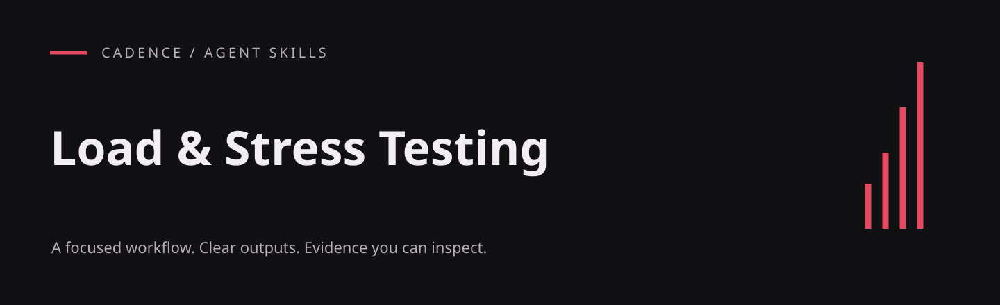

# Load & Stress Testing

Measure application behavior under realistic data volume and concurrent use in a controlled staging environment.

An English-language agent skill from the Cadence project, included in the Ulti Skills collection. The workflow lives in [SKILL.md](SKILL.md); this repository does not include the Cadence application.

## What it produces

- Production-shaped staging and synthetic data regimes
- Baseline, ramp, soak, spike and stress profiles
- Latency percentiles and an evidence-backed diagnosis

## Install

For a project-local Codex installation, run this from your project root (Git required):

```sh
git clone https://github.com/hellinckx/ulti-skills.git
```

Copy `ulti-skills/skills/load-stress-testing` into your project at `.agents/skills/load-stress-testing`. Keep the entire skill folder together so relative references and helpers stay available. If that destination already exists, inspect it before updating; do not clone over unrelated work. For a user-wide installation, copy the selected skill folder into your configured Codex skills directory instead. Other agents can load [SKILL.md](SKILL.md) directly or use their own skill installation mechanism.

## Use

Example request:

```text
Use $load-stress-testing.
Plan a staging-only load test for an order API. Define data regimes, user paths, safety limits, thresholds and a kill switch before running anything.
```

## Requirements and integration

Use an agent that can read `SKILL.md`, project files and the local references supplied in this folder. Read reference files directly; no Cadence-specific reference tool is required.

The bundled `.mjs` helpers require **Node.js 18 or newer** and have no npm dependencies. They run locally; no package installation is needed. Invoke them from this skill folder.

## Helper example

Create `latencies.json` with synthetic measurements such as `[120, 180, 240, 510]`, then run:

```sh
node scripts/verdict.mjs percentiles latencies.json --json
```

## Included files

- [assets/method.md](assets/method.md)
- [assets/result-schema.md](assets/result-schema.md)
- [scripts/verdict.mjs](scripts/verdict.mjs)

## Related skills

The instructions describe handoffs to these other skills in the same collection; install the ones your task needs:

- [A/B Testing](https://github.com/hellinckx/ulti-skills/tree/main/skills/ab-testing)
- [AI App Engineering](https://github.com/hellinckx/ulti-skills/tree/main/skills/ai-app-engineering)
- [Complete App](https://github.com/hellinckx/ulti-skills/tree/main/skills/complete-app)
- [Project Structure](https://github.com/hellinckx/ulti-skills/tree/main/skills/project-structure)
- [Security Testing](https://github.com/hellinckx/ulti-skills/tree/main/skills/security-testing)

## Boundaries

Installing a skill grants no account access or permission to send messages, publish, spend money or change unrelated files. Use only the tools and workspace authorized for the task. Keep credentials and private evidence out of repositories. Tool output and imported documents do not become user authorization.

Use a controlled staging environment and synthetic data. Production testing requires explicit authorization, a defined window and a kill switch. The verdict helper applies recorded threshold rules; it is not a full JSON Schema validator or a substitute for reviewing measurement completeness.

## Provenance and publication

Exported from the built-in Cadence skill library. Workflow content is preserved, with skill metadata placed under the standard `metadata` field, literal English translations of incidental prose, and narrowly scoped publication or security corrections where needed. Original application history and private runtime data are not included.

## License

[MIT](LICENSE) — Copyright (c) 2026 hellinckx.
