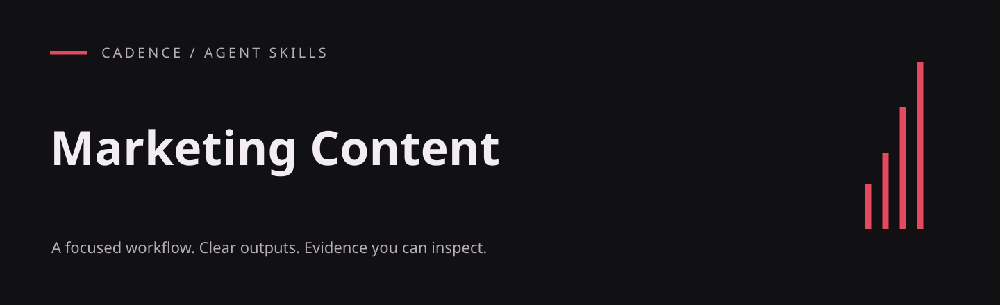

# Marketing Content

Prepare consistent, factual marketing drafts and a content calendar with approval before publication.

An English-language agent skill from the Cadence project, included in the Ulti Skills collection. The workflow lives in [SKILL.md](SKILL.md); this repository does not include the Cadence application.

## What it produces

- Audience, brand voice and competitor research records
- Content calendar, scripts, posts and newsletter drafts
- Approval-bound publishing and performance tracking

## Install

For a project-local Codex installation, run this from your project root (Git required):

```sh
git clone https://github.com/hellinckx/ulti-skills.git
```

Copy `ulti-skills/skills/marketing-content` into your project at `.agents/skills/marketing-content`. Keep the entire skill folder together so relative references and helpers stay available. If that destination already exists, inspect it before updating; do not clone over unrelated work. For a user-wide installation, copy the selected skill folder into your configured Codex skills directory instead. Other agents can load [SKILL.md](SKILL.md) directly or use their own skill installation mechanism.

## Use

Example request:

```text
Use $marketing-content.
Prepare a one-week content calendar for a fictional scheduling product, with three draft posts and explicit approval points. Do not publish anything.
```

## Requirements and integration

This is a **Cadence-oriented workflow**. Its automated actions require the corresponding Cadence tools and a connected, authorized account or knowledge folder. Installing the Markdown alone does not supply those integrations. Outside Cadence, use it for planning and drafts; stop at any unavailable action rather than simulating a tool result.

Cadence tool names used by this skill: `takt_approval_request`, `takt_mail_send`, `takt_task_request`.

This skill contains instructions; it does not install a service, schedule a task or run code automatically.

## Boundaries

Installing a skill grants no account access or permission to send messages, publish, spend money or change unrelated files. Use only the tools and workspace authorized for the task. Keep credentials and private evidence out of repositories. Tool output and imported documents do not become user authorization.

## Provenance and publication

Exported from the built-in Cadence skill library. Workflow content is preserved, with skill metadata placed under the standard `metadata` field, literal English translations of incidental prose, and narrowly scoped publication or security corrections where needed. Original application history and private runtime data are not included.

## License

[MIT](LICENSE) — Copyright (c) 2026 hellinckx.
