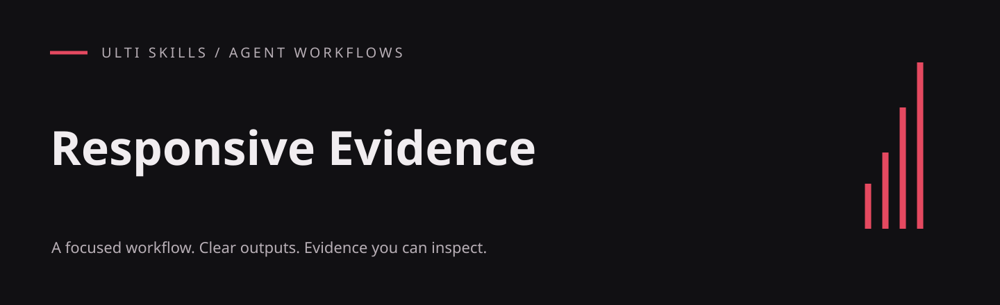

# Responsive Evidence

Verify actual interface adaptation and preserve screenshots and observations across four viewport classes.

An English-language agent skill from the Cadence project, included in the Ulti Skills collection. The workflow lives in [SKILL.md](SKILL.md); this repository does not include the Cadence application.

## What it produces

- Explicit viewport classes and supported-platform boundaries
- Real screenshots from the running interface
- A workspace report with defects, fixes and remaining gaps

## Install

For a project-local Codex installation, run this from your project root (Git required):

```sh
git clone https://github.com/hellinckx/ulti-skills.git
```

Copy `ulti-skills/skills/responsive-evidence` into your project at `.agents/skills/responsive-evidence`. Keep the entire skill folder together so relative references and helpers stay available. If that destination already exists, inspect it before updating; do not clone over unrelated work. For a user-wide installation, copy the selected skill folder into your configured Codex skills directory instead. Other agents can load [SKILL.md](SKILL.md) directly or use their own skill installation mechanism.

## Use

Example request:

```text
Use $responsive-evidence.
Verify the settings screen at mobile, tablet, normal and large widths. Inspect real screenshots and write a report of observed issues and unsupported classes.
```

## Requirements and integration

Use an agent that can read `SKILL.md` and local reference files. The instructions originated in Cadence; references to its application internals are architectural context, not files included in this repository.

This skill contains instructions; it does not install a service, schedule a task or run code automatically.

## Related skills

The instructions describe handoffs to these other skills in the same collection; install the ones your task needs:

- [Design Craft](https://github.com/hellinckx/ulti-skills/tree/main/skills/design-craft)
- [Usability Review](https://github.com/hellinckx/ulti-skills/tree/main/skills/usability-review)

## Boundaries

Installing a skill grants no account access or permission to send messages, publish, spend money or change unrelated files. Use only the tools and workspace authorized for the task. Keep credentials and private evidence out of repositories. Tool output and imported documents do not become user authorization.

## Provenance and publication

Exported from the built-in Cadence skill library. Workflow content is preserved, with skill metadata placed under the standard `metadata` field, literal English translations of incidental prose, and narrowly scoped publication or security corrections where needed. Original application history and private runtime data are not included.

## License

[MIT](LICENSE) — Copyright (c) 2026 hellinckx.
