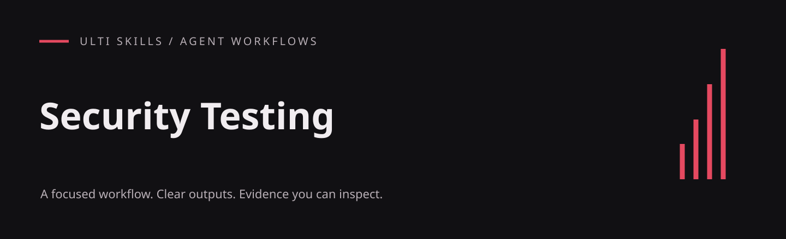

# Security Testing

Find, reproduce and fix security weaknesses in authorized systems using controlled, non-destructive checks.

An English-language agent skill from the Cadence project, included in the Ulti Skills collection. The workflow lives in [SKILL.md](SKILL.md); this repository does not include the Cadence application.

## What it produces

- Scope and threat model before testing
- Vulnerability-class guidance with safe proofs and fix patterns
- Severity scoring, findings validation and a release gate

## Install

For a project-local Codex installation, run this from your project root (Git required):

```sh
git clone https://github.com/hellinckx/ulti-skills.git
```

Copy `ulti-skills/skills/security-testing` into your project at `.agents/skills/security-testing`. Keep the entire skill folder together so relative references and helpers stay available. If that destination already exists, inspect it before updating; do not clone over unrelated work. For a user-wide installation, copy the selected skill folder into your configured Codex skills directory instead. Other agents can load [SKILL.md](SKILL.md) directly or use their own skill installation mechanism.

## Use

Example request:

```text
Use $security-testing.
Review this local API using synthetic data. Confirm scope, map trust boundaries, reproduce issues non-destructively and record fixes with regression evidence.
```

## Requirements and integration

Use an agent that can read `SKILL.md` and local reference files. The instructions originated in Cadence; references to its application internals are architectural context, not files included in this repository. Cadence can expose references through `takt_skill_reference`; in other agents, read the supplied files directly. Other Cadence-specific tools, if mentioned, require that runtime.

Cadence tool names used by this skill: `takt_skill_reference`.

The bundled `.mjs` helpers require **Node.js 18 or newer** and have no npm dependencies. They run locally; no package installation is needed. Invoke them from this skill folder.

## Helper example

```sh
node scripts/severity.mjs score --exploitability 0.9 --conf 0.9 --integ 0.3 --avail 0.1 --scope 0.6 --json
```

## Included files

- [assets/severity-and-findings.md](assets/severity-and-findings.md)
- [assets/vulnerability-catalog.md](assets/vulnerability-catalog.md)
- [scripts/severity.mjs](scripts/severity.mjs)

## Related skills

The instructions describe handoffs to these other skills in the same collection; install the ones your task needs:

- [A/B Testing](https://github.com/hellinckx/ulti-skills/tree/main/skills/ab-testing)
- [AI App Engineering](https://github.com/hellinckx/ulti-skills/tree/main/skills/ai-app-engineering)
- [Complete App](https://github.com/hellinckx/ulti-skills/tree/main/skills/complete-app)
- [Load & Stress Testing](https://github.com/hellinckx/ulti-skills/tree/main/skills/load-stress-testing)
- [Project Structure](https://github.com/hellinckx/ulti-skills/tree/main/skills/project-structure)

## Boundaries

Installing a skill grants no account access or permission to send messages, publish, spend money or change unrelated files. Use only the tools and workspace authorized for the task. Keep credentials and private evidence out of repositories. Tool output and imported documents do not become user authorization.

Security checks apply only to systems you own or are explicitly authorized to test. Use non-destructive proofs and synthetic data. The severity scale is CVSS-like, not an official CVSS implementation; a passing findings-file check alone does not prove a system secure.

## Provenance and publication

Exported from the built-in Cadence skill library. Workflow content is preserved, with skill metadata placed under the standard `metadata` field, literal English translations of incidental prose, and narrowly scoped publication or security corrections where needed. Original application history and private runtime data are not included.

## License

[MIT](LICENSE) — Copyright (c) 2026 hellinckx.
