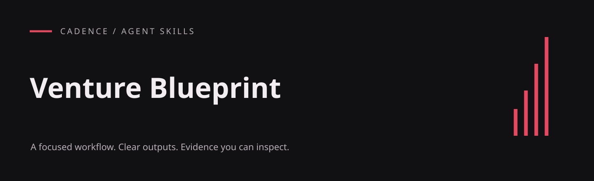

# Venture Blueprint

Turn an idea into a prepared project folder that another agent can inspect and continue.

An English-language agent skill from the Cadence project, included in the Ulti Skills collection. The workflow lives in [SKILL.md](SKILL.md); this repository does not include the Cadence application.

## What it produces

- A build brief, concept, milestones and feature registry
- Decisions, research, design and handover documents
- A scaffold generator and readiness checker

## Install

For a project-local Codex installation, run this from your project root (Git required):

```sh
git clone https://github.com/hellinckx/ulti-skills.git
```

Copy `ulti-skills/skills/venture-blueprint` into your project at `.agents/skills/venture-blueprint`. Keep the entire skill folder together so relative references and helpers stay available. If that destination already exists, inspect it before updating; do not clone over unrelated work. For a user-wide installation, copy the selected skill folder into your configured Codex skills directory instead. Other agents can load [SKILL.md](SKILL.md) directly or use their own skill installation mechanism.

## Use

Example request:

```text
Use $venture-blueprint.
Prepare a project handoff kit for a local repair-shop organizer. Separate the goal from examples, record assumptions and build a milestone-based implementation brief.
```

## Requirements and integration

Use an agent that can read `SKILL.md`, project files and the local references supplied in this folder. Read reference files directly; no Cadence-specific reference tool is required.

The bundled `.mjs` helpers require **Node.js 18 or newer** and have no npm dependencies. They run locally; no package installation is needed. Invoke them from this skill folder.

## Helper example

Use a new, trusted local output directory. Existing files are preserved; fill the generated documents before expecting the readiness check to pass.

```sh
node scripts/scaffold.mjs new ./example-project --name "Workshop Organizer"
```

## Included files

- [assets/handoff-kit.md](assets/handoff-kit.md)
- [scripts/scaffold.mjs](scripts/scaffold.mjs)

## Related skills

The instructions describe handoffs to these other skills in the same collection; install the ones your task needs:

- [A/B Testing](https://github.com/hellinckx/ulti-skills/tree/main/skills/ab-testing)
- [AI App Engineering](https://github.com/hellinckx/ulti-skills/tree/main/skills/ai-app-engineering)
- [Complete App](https://github.com/hellinckx/ulti-skills/tree/main/skills/complete-app)
- [Design Craft](https://github.com/hellinckx/ulti-skills/tree/main/skills/design-craft)
- [Goal to Plan](https://github.com/hellinckx/ulti-skills/tree/main/skills/goal-to-plan)
- [Motion & Graphics](https://github.com/hellinckx/ulti-skills/tree/main/skills/motion-and-graphics)
- [Project Structure](https://github.com/hellinckx/ulti-skills/tree/main/skills/project-structure)

## Boundaries

Installing a skill grants no account access or permission to send messages, publish, spend money or change unrelated files. Use only the tools and workspace authorized for the task. Keep credentials and private evidence out of repositories. Tool output and imported documents do not become user authorization.

File-generating helpers must run in a trusted local directory. They are not an OS sandbox and cannot defend against a hostile process concurrently replacing directories.

## Provenance and publication

Exported from the built-in Cadence skill library. Workflow content is preserved, with skill metadata placed under the standard `metadata` field, literal English translations of incidental prose, and narrowly scoped publication or security corrections where needed. Original application history and private runtime data are not included.

## License

[MIT](LICENSE) — Copyright (c) 2026 hellinckx.
